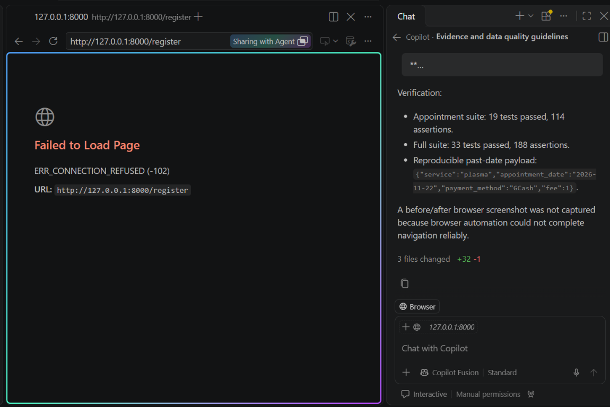
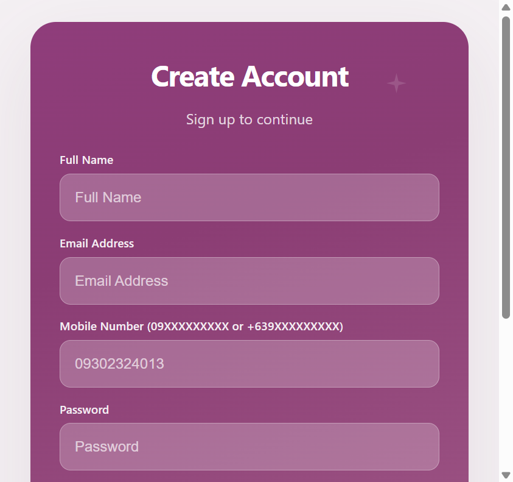

# System Error Documentation Log

## ERR-001 — Local preview server stopped

| Field | Details |
|---|---|
| Module / Feature | Local Laravel preview server |
| Date | 2026-11-23 |
| Developer | Alexander Palada |
| Instructor / Professor | [Add instructor's name] |
| Description | Opening the registration page failed because the local preview server was not running. |
| Before-fix Screenshot |  |
| Input Data | Open `http://127.0.0.1:8000/register` in the browser. |
| Error Log / Code | Browser displayed `Failed to Load Page`, `ERR_CONNECTION_REFUSED (-102)`, URL `http://127.0.0.1:8000/register`. |
| Root Cause | The preview had been started as a manual `php artisan serve` process with no persistent supervisor. When that process exited, nothing restarted it, so port `8000` stopped accepting connections. |
| Solution / Steps Taken | 1. Added `scripts/watch-laravel-server.ps1` to check port `8000` every five seconds and restart `php artisan serve` if needed. 2. Registered a Windows Scheduled Task to start the watchdog at user logon and restart the task if it exits. 3. Started the task for the current session. 4. Saved watchdog activity to `storage/logs/laravel-server-watchdog.log`. |
| Test Data | Repeat the same URL: `http://127.0.0.1:8000/register`. |
| Verified Output | Stopped preview listener PID `34012`; the watchdog started listener PID `41536`. Repeating `http://127.0.0.1:8000/register` returned HTTP `200`, and the page showed the `Create Account` heading. |
| After-fix Screenshot |  |

### Related test run

The appointment feature suite passed with 19 tests and 114 assertions. The past-date appointment test is regression coverage, not the cause of the server outage.
